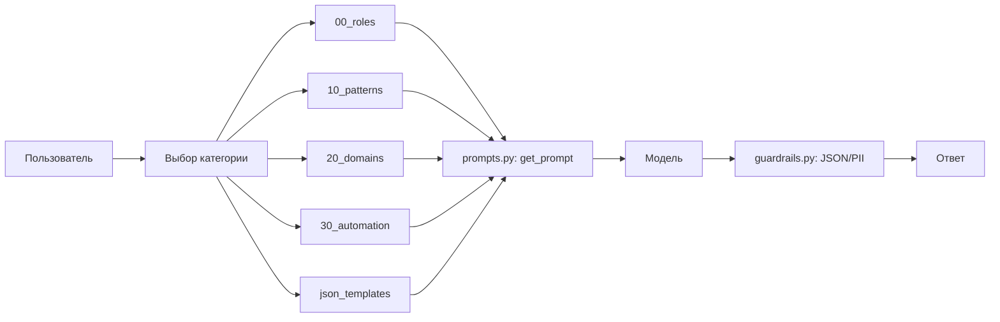

# Prompt Library

Личная библиотека промтов для LLM: шаблоны, роли, паттерны и JSON-схемы.

## Структура
- `00_roles/` — роли (senior_dev, product_analyst, marketer, SRE).
- `10_patterns/` — универсальные паттерны (улучшить текст, сократить, структурировать, задать вопросы).
- `20_domains/` — доменные промты (marketing, product, dev).
- `30_automation/` — шаблоны для автоматизации (отчёты, пайплайны).
- `json_templates/` — 10 универсальных JSON-шаблонов.

## Как пользоваться
1. Найдите нужный шаблон в соответствующей папке.
2. Скопируйте промт.
3. Замените переменные в `<<...>>` на свои данные.
4. Запустите в любой LLM.

## Версионирование
Каждый промт имеет версию в названии (например, `landing_basic_v1.md`). Изменения фиксируются в Git.

## Автор
redsea1970

## Оценка

Библиотека содержит 23 промпта в 5 категориях:

| Категория | Количество | Что внутри |
|---|---|---|
| 00_roles | 3 | senior_dev, product_analyst, marketer |
| 10_patterns | 2 | improve_text, summarize |
| 20_domains | 3 папки | dev, marketing, product |
| 30_automation | 2 | weekly_sales_report, data_to_insights_pipeline |
| json_templates | 10 | review_analysis, content_plan, jtbd, rice, weekly_report, code_review, test_generation, business_ideas, mini_prd, meta_prompt |

**Итог:** 23 промпта, у каждого версия в названии (`*_v1.md`), изменения фиксируются в Git. `prompts.py` в корне — программный доступ к промптам.

## Ограничения

- Промпты не протестированы автоматически: нет accuracy/F1, только ручная проверка.
- Нет конвейера оценки (AI-судья, pairwise comparison) — для production нужен.
- `json_templates` — это шаблоны, а не валидированные схемы: JSON-валидация через `guardrails.py` (функция `is_valid_json`).
- Для production нужно: добавить тесты для каждого промпта, версионировать через `prompts.py` с метаданными, подключить guardrails на входе и выходе.

## Архитектура

